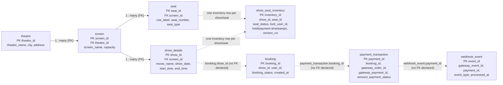

# BookMyShow Database Design

A MySQL schema for theatres, screens, seats, shows, per-show seat availability, bookings, payments, and payment webhook events. The SQL also includes sample data and statements illustrating a seat hold, booking, payment, webhook event, and an availability query.

## Entity model



Solid relationships are enforced by foreign keys in `bookmyshow.sql`. Dashed relationships are represented by columns but are not declared as foreign keys in the current schema. `user_id` is also stored on bookings, but there is no user table in this SQL file.

## Entities and relationships

| Entity | Purpose and key relationships |
| --- | --- |
| `theatre` | Theatre name, city, and address. A theatre has multiple screens. |
| `screen` | Belongs to a theatre and has a name and capacity. A screen has seats and scheduled shows. |
| `seat` | A physical seat on a screen, with a row, number, and type (`REGULAR`, `PREMIUM`, or `RECLINER`). `(screen_id, row_label, seat_number)` is unique. |
| `show_details` | A movie show scheduled on a screen, with date and start/end times. |
| `show_seat_inventory` | Availability and temporary lock/payment state for one seat at one show. `(show_id, seat_id)` is unique. |
| `booking` | A user's booking for a show, with status (`PENDING`, `CONFIRMED`, `FAILED`, or `CANCELLED`). |
| `payment_transaction` | Payment attempt associated with a booking, including gateway identifiers, amount, and status. `gateway_order_id` is unique. |
| `webhook_event` | A received payment-gateway event. `gateway_event_id` is unique, allowing duplicate delivery detection. |

## Seat reservation and concurrency

`show_seat_inventory` keeps availability separate for every show, even when the same physical seat appears in multiple shows. Its status values define the reservation lifecycle:

```text
AVAILABLE -> HELD -> PAYMENT_IN_PROGRESS -> BOOKED
                 \-> AVAILABLE (hold expires or reservation fails)
```

The inventory row stores `lock_user_id`, `hold_started_at`, and `hold_expires_at` for a temporary hold, and `payment_started_at` while payment is underway. `idx_show_status` helps find seats by show and status; `idx_hold_expiry` helps find expired holds. `version_no` can support optimistic version checks if the application uses them.

For concurrent requests, treat the inventory row as the serialization point and use **pessimistic row locking** in a database transaction:

1. Begin a transaction and select the requested `(show_id, seat_id)` inventory row using `SELECT ... FOR UPDATE`.
2. Verify it is `AVAILABLE` (or its existing `HELD` state has expired); then set it to `HELD` with the user and expiry time.
3. Commit promptly. A competing transaction for the same row waits, then sees the updated state and must not create another hold.
4. When payment starts, change the held seat to `PAYMENT_IN_PROGRESS` only if the caller still owns a valid hold. On confirmed payment, atomically confirm the booking and mark the inventory `BOOKED`; on failure/expiry, release it according to the reservation policy.

The unique `(show_id, seat_id)` constraint prevents duplicate inventory rows for a show-seat pair. However, the schema and example `UPDATE` statements alone do **not** implement the transaction, row lock, ownership/expiry checks, or conditional state transitions. Those must be performed by the application (or stored procedures) for the concurrency guarantee to hold. The sample seat updates use `inventory_id` alone and should not be treated as a complete concurrent booking implementation.

## Idempotent payment webhooks

`webhook_event.gateway_event_id` is unique, so the same gateway event cannot be recorded as multiple event rows. `payment_transaction.gateway_order_id` is also unique, helping correlate a gateway order to a payment attempt.

For reliable webhook processing, verify the gateway notification and handle it in a transaction: insert the event using its stable gateway event ID, then update the payment, booking, and associated seat inventory as one atomic operation. If the event ID already exists, treat the delivery as a duplicate and return a successful acknowledgement without applying the state transition again. If processing fails before commit, roll back so a retry can safely process the event. Also make state updates conditional on the current payment/booking state so distinct or out-of-order notifications cannot regress a completed booking.

The unique key provides the database primitive for deduplication, but the sample SQL uses a plain `INSERT` and does not show duplicate handling, gateway signature verification, transactional processing, or state-transition checks. Implement those behaviors in the webhook handler; do not assume the table definition alone makes webhook processing idempotent.

## Schema notes

- The SQL declares foreign keys from `screen` to `theatre`, `seat` to `screen`, and `show_details` to `screen`.
- `show_seat_inventory.show_id` / `seat_id`, `booking.show_id`, `payment_transaction.booking_id`, and `webhook_event.payment_id` are logical references; foreign-key constraints are not declared for them.
- `user_id` is present on `booking`, but user identity is outside the scope of the supplied SQL.
- The script uses MySQL-specific features such as `AUTO_INCREMENT`, `ENUM`, `NOW()`, `DATE_ADD`, and `TIME_FORMAT`.
